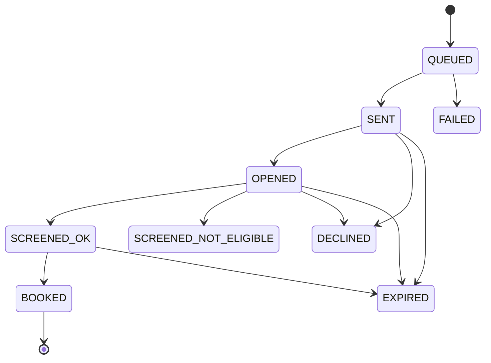
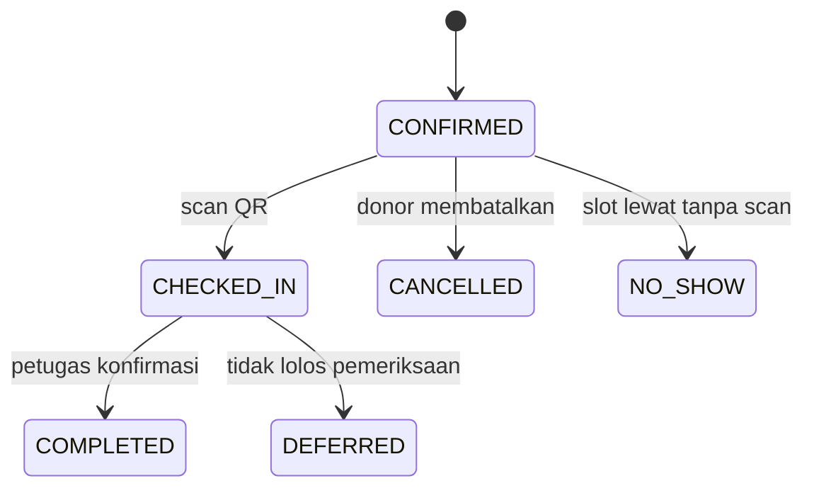
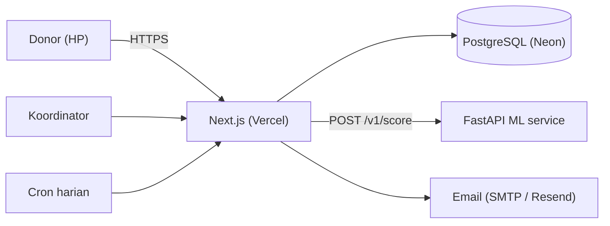
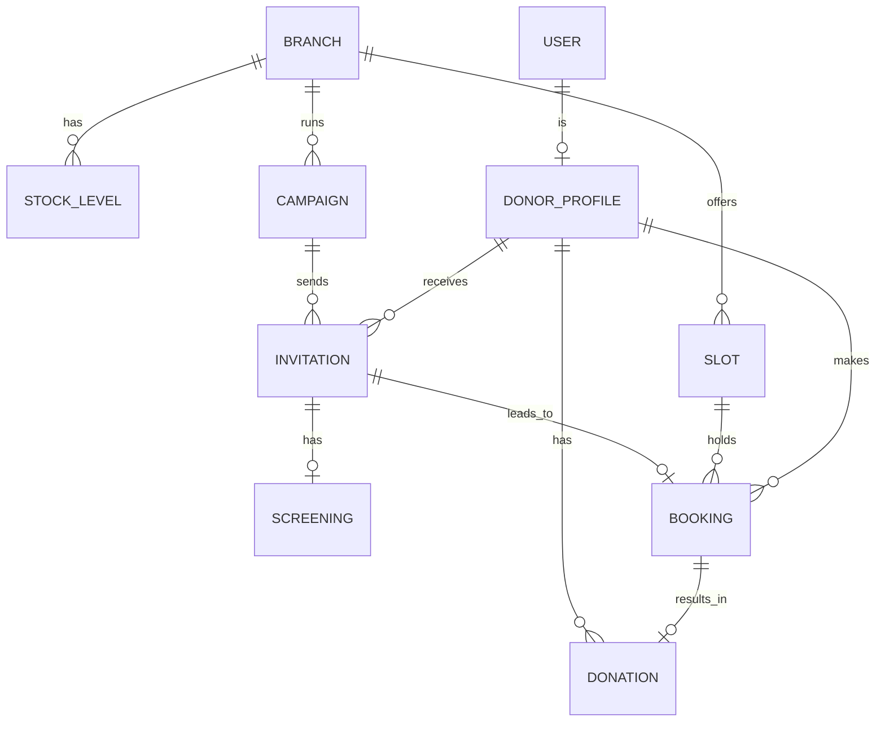

# Nadi Kita — Rencana Pengembangan (planning.md)

Tim Kita Peduli · STACK 2026 · Case 2: Stronger Communities and Everyday Services
Versi 1.0 · 8 November 2026 · Status: draf untuk disepakati tim

Dokumen pendamping: `design.md` (sistem desain, palet, wireframe, microcopy).

---

## 1. Ringkasan dan keputusan kunci

**Satu kalimat.** Nadi Kita adalah aplikasi web full-stack yang menghubungkan stok darah UTD dengan donor yang sudah melewati masa jeda, lalu mengatur jam kedatangan mereka lewat slot 30 menit dan tiket QR agar tidak menumpuk di lokasi.

**Bentuk produk.** Website dinamis dengan basis data, autentikasi, tiga peran (donor, koordinator, admin), pembaruan stok hampir real-time, mesin aturan kelayakan, ranking donor oleh model ML, booking slot yang aman dari bentrok, dan check-in QR. Satu cabang simulasi ("UTD Simulasi Surabaya"), delapan golongan darah.

### Keputusan kunci

| ID | Keputusan | Alasan | Konsekuensi |
|---|---|---|---|
| K1 | Satu aplikasi Next.js (UI + API) ditambah satu layanan ML kecil berbasis FastAPI | Tim 3 orang; satu repo web mudah di-deploy dan di-debug. Layanan Python tetap ada sesuai abstrak | Perlu fallback bila layanan ML tidur atau down (lihat 10.4) |
| K2 | Skor ML hanya untuk **prioritas undangan**. Kelayakan donor ditentukan **aturan eksplisit** | Model tidak boleh memutuskan hal medis. Aturan harus bisa dibaca, diuji, dan diubah petugas | Dua komponen terpisah: `rules/` (deterministik) dan `ml/` (probabilistik) |
| K3 | Aturan (masa jeda, berat minimum, dst.) disimpan sebagai **konfigurasi per cabang**, bukan konstanta | Sumber publik berbeda soal interval donor (lihat 2.3, T2) | Ganti angka tanpa deploy ulang |
| K4 | Timer jeda 60 hari di-reset saat petugas menandai **"Selesai donor"**, bukan saat QR dipindai | Orang yang sudah check-in bisa saja ditolak saat pemeriksaan di lokasi | Alur: scan QR (hadir) → petugas konfirmasi hasil. Tetap satu alur QR, hanya ada satu langkah tambahan |
| K5 | Dataset tiga lapis: UCI untuk melatih model, generator data sintetis untuk isi aplikasi, akun relawan untuk uji coba | Tidak ada akses ke data PMI nyata (risiko utama di abstrak) dan data kesehatan nyata tidak boleh dipakai sembarangan | Semua data di demo ditandai simulasi |
| K6 | Notifikasi: email + tautan WhatsApp yang dikirim koordinator secara manual. WhatsApp Business API di luar cakupan | API resmi berbayar dan butuh verifikasi bisnis. Tautan `wa.me` gratis dan sesuai kebiasaan koordinator | Undangan punya tiga jalur: email, salin tautan, tombol WhatsApp |
| K7 | Pembaruan data memakai polling 10–15 detik, bukan WebSocket | Cukup untuk "live" pada skala ini dan cocok dengan hosting serverless | Hindari SSE/WebSocket di Vercel Hobby |
| K8 | Semua klaim di abstrak (di bawah 2 menit, di bawah 3 menit) diukur lewat tabel `EventLog`, bukan ditebak | Klaim yang terukur lebih kuat saat penjurian | Instrumentasi dibangun sejak Minggu 2 |
| K9 | UI berbahasa Indonesia. Teks disimpan di kamus pesan sejak awal; README dan narasi demo berbahasa Inggris | Pengguna nyata berbahasa Indonesia, abstrak berbahasa Inggris | Pakai `next-intl`; `id` lengkap, `en` untuk halaman publik dan alur donor bila sempat |
| K10 | Hanya mode terang pada v1 | Palet pastel pamflet dirancang untuk latar terang | Mode gelap masuk daftar "Could" |

---

## 2. Analisis abstrak

### 2.1 Pemahaman

Abstrak mengusulkan alur empat langkah: (1) koordinator UTD memperbarui stok delapan golongan darah dan memicu peringatan massal saat satu golongan di bawah ambang; (2) sistem meranking donor yang sudah lewat 60 hari dan mengirim undangan; (3) donor mengisi pemeriksaan awal empat pertanyaan lalu memesan slot 30 menit; (4) donor check-in dengan QR dan timer 60 hari di-reset. Teknologinya Next.js, React, Tailwind, PostgreSQL, serta layanan Python yang melatih model dari dataset UCI Blood Transfusion. Uji coba dua minggu dengan 15 relawan mahasiswa. Rencana tiga minggu.

### 2.2 Yang sudah kuat

- Masalahnya konkret dan sempit: stok golongan tertentu tiba-tiba habis, donor lupa kapan boleh donor lagi, antrean tidak terlihat.
- Cakupan v1 realistis: satu cabang, delapan golongan, alur inti saja.
- Ada rencana pengukuran (waktu undang dan waktu booking) dan risiko utama dinyatakan jujur (akses data PMI).
- Pembeda dengan portal yang ada jelas: portal hanya menampilkan angka statis, Nadi Kita menutup lingkarannya (stok → undangan → jadwal → kehadiran).

### 2.3 Temuan dan tindak lanjut

| ID | Temuan | Mengapa penting | Tindakan di rencana ini |
|---|---|---|---|
| T1 | Dataset UCI berasal dari pusat darah di Hsin-Chu, Taiwan, dengan 748 baris dan target "donor pada Maret 2007". Konteksnya berbeda dari Indonesia 2026 | Juri bisa mempertanyakan validitas. Skor tidak boleh diklaim sebagai probabilitas respons nyata | Skor dinamai **skor kecenderungan kembali** dan dipakai sebagai prior peringkat. Evaluasi hanya offline (AUC, PR-AUC, Brier, lift) dan dilaporkan apa adanya, dengan model card yang menyebut batasan (bagian 10) |
| T2 | Interval donor berbeda di berbagai sumber publik. PMI merujuk Permenkes 91/2015 dengan minimal 2 bulan; sumber lain menyebut 10 minggu atau 12 minggu | Angka 60 hari di abstrak bisa dipersoalkan, dan di UTD tertentu bisa berbeda | `cooldownDays` menjadi konfigurasi per cabang dengan default 60. **Validasi ke satu petugas UTD atau KSR sebelum demo** |
| T3 | Abstrak menulis timer di-reset saat check-in QR | Check-in bukan bukti donor berhasil | K4: reset saat "Selesai donor". Di presentasi sebut "QR check-in lalu konfirmasi petugas" agar konsisten dengan abstrak |
| T4 | Pemeriksaan awal mandiri (berat, tidur, riwayat Hb, tanggal donor terakhir) bersifat laporan sendiri | Bukan pengganti seleksi medis dan bisa disalahpahami sebagai diagnosis | Hasil selalu diberi penegasan bahwa petugas UTD memeriksa ulang. Jawaban "tidak tahu" untuk Hb tidak memblokir, hanya diberi penanda |
| T5 | Klaim "di bawah dua menit" dan "di bawah tiga menit" belum punya definisi awal dan akhir | Tanpa definisi, klaim tidak bisa diverifikasi | Definisi dan event pengukuran ada di bagian 16. Laporkan median dan rentang (n=15), bukan klaim signifikansi statistik |
| T6 | Stok "live" bergantung pada koordinator mengetik angka | Angka lama yang tampil seperti baru bisa menyesatkan | Setiap angka menampilkan "diperbarui X menit lalu". Lewat 6 jam muncul peringatan data lama |
| T7 | Abstrak tidak menyebut kanal pengiriman undangan | Ini penentu apakah alurnya jalan di lapangan | K6 |
| T8 | Data kesehatan donor tergolong data pribadi spesifik menurut UU PDP (UU No. 27/2022) | Pelanggaran privasi adalah risiko etika dan reputasi | Data demo sintetis, persetujuan eksplisit untuk akun relawan, tidak menyimpan NIK, hapus data uji setelah acara (bagian 13) |
| T9 | Kolom "Monetary" di dataset UCI adalah 250 cc × Frequency, jadi redundan | Fitur kolinear mengacaukan koefisien model | Buang Monetary. Gunakan Recency, Frequency (log), Tenure (diverifikasi saat EDA) |
| T10 | "Tiga layar" di abstrak tidak cukup untuk situs nyata (login, riwayat, kelola slot, dll.) | Perlu mengatur ekspektasi | Cakupan dinyatakan sebagai **tiga alur inti**: stok & permintaan, undangan → pemeriksaan → jadwal, tiket → check-in. Halaman pendukung dibatasi (bagian 3 dan 11) |
| T11 | Rentang usia pengguna 18–45 di abstrak berbeda dari syarat donor (umumnya 17–60) | Bisa dianggap tidak konsisten | Syarat kelayakan mengikuti konfigurasi (17–60). 18–45 diperlakukan sebagai **segmen sasaran pilot** |
| T12 | Sumber [1] dan [2] di abstrak perlu dicek ulang sebelum submit | Tautan atau angka yang meleset merugikan kredibilitas | Tambahkan ke daftar periksa pengiriman (bagian 19) |

### 2.4 Selisih rencana terhadap abstrak

Daftar ini disiapkan agar presentasi dan demo konsisten dengan abstrak yang sudah dikirim.

| Abstrak | Rencana | Cara menjelaskannya |
|---|---|---|
| Tiga layar | Tiga alur inti, sekitar 12 halaman | "Tiga alur inti, dengan halaman pendukung seperti login dan riwayat" |
| Check-in QR mereset timer | Scan QR, lalu konfirmasi "Selesai donor" mereset timer | Satu alur QR, dengan satu langkah verifikasi petugas |
| Layanan ML Python | Tetap, dengan fallback dan opsi Plan B (10.4) | Tidak perlu dijelaskan kecuali ditanya |
| Data anonim historis [3] | Ditambah data sintetis berbentuk aplikasi (9.2) | "UCI untuk melatih model, data sintetis untuk mengisi aplikasi" |

---

## 3. Ruang lingkup

### 3.1 MoSCoW

| Prioritas | Fitur |
|---|---|
| **Must** | Login multi-peran · Input dan tampil stok 8 golongan · Halaman stok publik yang diperbarui otomatis · Pembuatan permintaan donor dengan pratinjau ranking · Pengiriman undangan (email + tautan salin + tombol WhatsApp) · Tautan undangan bertoken · Pemeriksaan awal 4 pertanyaan dengan mesin aturan · Pemilihan slot 30 menit tanpa overbooking · Tiket QR + kode cadangan · Pemindai QR dan konfirmasi hasil · Reset timer dan riwayat donor · Log event untuk metrik · Data seed + skrip reset demo |
| **Should** | Alasan peringkat per donor ("donor rutin, terakhir 4 bulan lalu") · Halaman metrik uji coba · Pengingat H-1 lewat email · Batalkan atau ubah jadwal · Peringatan kandidat kurang dari target · Tambah ke kalender (.ics) · Pembatasan frekuensi undangan per donor |
| **Could** | Versi bahasa Inggris · Tiket dapat diakses offline (PWA ringan) · Ekspor CSV laporan permintaan · Mode gelap · Beberapa cabang |
| **Won't (v1)** | Integrasi WhatsApp Business API · Integrasi sistem SIMDONOR/PMI nyata · Hasil uji laboratorium atau status kantong · Pembayaran/insentif · Aplikasi native · Rekomendasi medis |

### 3.2 Definisi selesai (Definition of Done)

Satu fitur dianggap selesai bila: kode lolos lint, typecheck, dan tes · aturan bisnisnya punya tes unit · jalur sedih (error, kosong, kedaluwarsa) ditangani dengan pesan jelas · tampil benar di lebar 360 px · bisa dipakai dengan keyboard · event pengukurannya tercatat · sudah di-review satu anggota lain lewat pull request.

---

## 4. Pengguna

**Koordinator UTD (misalnya Bu Ratna, 38, petugas pelayanan donor).** Setiap pagi memeriksa stok, menghubungi donor lewat grup WhatsApp, dan mencatat kedatangan di buku. Tugasnya: mendeteksi golongan yang menipis lebih awal, memilih siapa yang dihubungi tanpa mengganggu donor yang masih dalam masa jeda, dan mengatur kedatangan agar tempat tidur donor tidak kosong lalu penuh.

**Donor berulang (misalnya Rizky, 23, mahasiswa).** Pernah donor dua kali, lupa kapan boleh lagi, malas datang bila tidak tahu antreannya. Tugasnya: tahu kapan dirinya boleh donor, menerima ajakan yang relevan (golongan darah sendiri, saat memang boleh), memesan jam dalam hitungan menit, dan datang tanpa antre.

Nama di atas hanya persona untuk diskusi dan skenario uji.

---

## 5. Alur dan state

### 5.1 Alur inti (end to end)

1. Koordinator memperbarui stok. Bila angka masuk zona kritis atau menipis, dasbor menandai golongan itu.
2. Koordinator membuat permintaan donor: golongan, target kantong, batas waktu. Sistem menampilkan pratinjau ranking, lalu koordinator menekan kirim.
3. Donor membuka tautan undangan, mengisi pemeriksaan awal, memilih slot, dan menerima tiket QR.
4. Di lokasi, petugas memindai QR. Setelah pemeriksaan dan donor, petugas menekan "Selesai donor". Timer 60 hari mulai dari hari itu.

### 5.2 State undangan



### 5.3 State booking



`NO_SHOW` dihitung secara lazy saat data dibaca (slot berakhir + toleransi), lalu dirapikan oleh cron harian.

---

## 6. Aturan bisnis

Semua angka berasal dari `EligibilityConfig` per cabang (Lampiran A).

| ID | Aturan |
|---|---|
| BR-01 | Donor layak diundang bila: golongan darah sama persis dengan permintaan (ABO + Rh), akun aktif dan memberi izin dihubungi, usia dalam rentang, `now - lastDonationAt ≥ cooldownDays` (atau belum pernah donor), tidak punya booking aktif, dan belum melewati batas undangan per 30 hari |
| BR-02 | Skor ML hanya dipakai untuk mengurutkan donor yang sudah layak. Donor baru tanpa riwayat memakai prior `firstTimerPrior` (default 0,20) dan ditandai "donor baru" |
| BR-03 | Prioritas = `p × (1 − 0,5 × kelelahan)`, dengan `kelelahan = undangan 30 hari terakhir ÷ maksimum per 30 hari` (rentang 0–1) |
| BR-04 | Jumlah undangan K dipilih sebagai bilangan terkecil sehingga jumlah `p` dari K donor teratas ≥ `target × overInviteFactor` (default 1,5), dibatasi `maxInvitesPerCampaign`. Koordinator dapat mengubah K secara manual di pratinjau |
| BR-05 | Bila kandidat layak kurang dari yang dibutuhkan, tampilkan peringatan "Kandidat layak hanya N, target mungkin tidak tercapai" dan sarankan memperpanjang batas waktu atau menghubungi UTD lain |
| BR-06 | Bila kapasitas slot sampai batas waktu lebih kecil dari K, tampilkan peringatan kapasitas dan tawarkan membuka slot tambahan |
| BR-07 | Tautan undangan memakai token acak 32 byte, hanya hash-nya yang disimpan, berlaku sampai `expiresAt` (default 48 jam atau batas waktu permintaan, mana yang lebih dulu). Tautan hanya memberi akses ke pemeriksaan, booking, dan tiket untuk undangan itu |
| BR-08 | Pemeriksaan awal dinilai oleh fungsi murni `evaluateScreening(input, config)` yang mengembalikan `eligible`, `reasons[]`, `nextEligibleDate?`, `flags[]`. Tidak ada pemanggilan ML di sini |
| BR-09 | Booking butuh slot dengan `bookedCount < capacity` dan mulai lebih dari `bookBeforeMin` menit lagi. Pembaruan penghitung dilakukan atomik. Satu donor hanya boleh punya satu booking aktif (indeks unik parsial) |
| BR-10 | Pembatalan boleh sampai `cancelBeforeMin` menit sebelum slot dan mengembalikan kapasitas |
| BR-11 | Check-in valid dari `before` menit sebelum sampai `after` menit sesudah awal slot. Di luar jendela, sistem menolak dan menampilkan jam yang benar. Check-in idempotent: memindai dua kali tidak mengubah apa pun |
| BR-12 | "Selesai donor" membuat catatan `Donation`, mengisi `lastDonationAt`, menambah `donationCount`, menghitung `nextEligibleAt = lastDonationAt + cooldownDays`, dan menutup undangan. "Ditunda" mencatat alasan tanpa mereset timer |
| BR-13 | Perubahan stok selalu menulis `AuditLog` (sebelum, sesudah, aktor, alasan). Stok tidak bisa negatif |
| BR-14 | Golongan darah, tanggal lahir, dan riwayat donor hanya bisa diubah koordinator atau donor sendiri dan dicatat di `AuditLog` |
| BR-15 | Semua waktu disimpan UTC dan ditampilkan dalam WIB (Asia/Jakarta) |

---

## 7. Arsitektur



### 7.1 Tumpukan teknologi

| Lapisan | Pilihan | Catatan |
|---|---|---|
| Framework | Next.js (App Router), React, TypeScript strict | Gunakan versi stabil terbaru saat init, lalu kunci versi |
| Gaya | Tailwind CSS v4 dengan token dari `design.md` | Reset palet bawaan agar tidak ada warna di luar palet |
| Komponen | Radix UI primitives (atau shadcn/ui yang di-restyle penuh) | Gaya bawaan shadcn tidak dipakai apa adanya |
| Basis data | PostgreSQL di Neon (tier gratis) | Neon branching berguna untuk uji migrasi |
| ORM | Prisma | Alternatif: Drizzle. Pilih satu di Hari 0 |
| Auth | Better Auth (email + password, magic link) | Sepengetahuan saya, proyek Auth.js kini dikelola bersama tim Better Auth dan menyarankannya untuk proyek baru. Cek dokumentasi terbaru. Jangan menulis auth sendiri |
| Validasi | Zod, dipakai bersama di klien dan server | |
| Data fetching | Server Components + SWR (polling) | `refreshInterval` 10–15 detik |
| QR | `qrcode` (membuat), `@yudiel/react-qr-scanner` atau `html5-qrcode` (memindai) | Kamera butuh HTTPS. Sediakan input kode manual |
| Email | Resend dengan domain terverifikasi, atau Nodemailer + SMTP (Brevo/Gmail App Password) | Sepengetahuan saya, Resend hanya bisa mengirim ke alamat sendiri tanpa domain terverifikasi. Tentukan sebelum uji coba |
| ML | Python 3.12, pandas, scikit-learn, FastAPI, uvicorn | Model: regresi logistik terkalibrasi |
| Tes | Vitest (unit), Playwright (e2e), axe (aksesibilitas), pytest (ML) | |
| CI | GitHub Actions: lint → typecheck → test → migrate check | |
| Hosting web | Vercel Hobby | Cron Hobby hanya sekali sehari |
| Hosting ML | Google Cloud Run (scale-to-zero) atau Render free | Render gratis tidur saat tidak dipakai. Mitigasi: ping pemanasan dari halaman pembuatan permintaan |
| Observabilitas | Log Vercel + tabel `EventLog`; Sentry opsional | Tanpa analitik pihak ketiga (privasi) |

### 7.2 Tanggung jawab komponen

- **Web (Next.js):** UI, API, autentikasi, mesin aturan, orkestrasi ranking, email, cron.
- **ML service:** hanya menghitung skor dan alasan dari fitur riwayat donor. Tanpa akses basis data. Stateless.
- **Basis data:** sumber kebenaran, termasuk invarian penting (indeks unik, constraint kapasitas).

---

## 8. Model data

### 8.1 ERD



Tabel autentikasi (user, session, account) dikelola Better Auth. Di bawah hanya tabel domain.

### 8.2 Draf skema Prisma

```prisma
generator client { provider = "prisma-client-js" }
datasource db   { provider = "postgresql"; url = env("DATABASE_URL") }

enum Role            { DONOR COORDINATOR ADMIN }
enum BloodGroup      { A_POS A_NEG B_POS B_NEG AB_POS AB_NEG O_POS O_NEG }
enum Sex             { F M }
enum CampaignStatus  { DRAFT ACTIVE CLOSED CANCELLED }
enum InvitationStatus{ QUEUED SENT OPENED SCREENED_OK SCREENED_NOT_ELIGIBLE BOOKED DECLINED EXPIRED FAILED }
enum BookingStatus   { CONFIRMED CHECKED_IN COMPLETED DEFERRED NO_SHOW CANCELLED }
enum HbStatus        { OK LOW UNKNOWN }

model Branch {
  id          String   @id @default(cuid())
  name        String
  city        String
  isSimulated Boolean  @default(true)
  rules       Json                       // EligibilityConfig (Lampiran A)
  stock       StockLevel[]
  slots       Slot[]
  campaigns   Campaign[]
}

model StockLevel {
  id         String     @id @default(cuid())
  branchId   String
  group      BloodGroup
  units      Int
  criticalAt Int
  safeAt     Int
  updatedAt  DateTime   @updatedAt
  updatedBy  String?
  branch     Branch     @relation(fields: [branchId], references: [id])
  @@unique([branchId, group])
}

model DonorProfile {
  id              String     @id @default(cuid())
  userId          String?    @unique        // null untuk donor sintetis tanpa akun
  fullName        String
  email           String?
  phone           String?
  birthDate       DateTime
  sex             Sex
  bloodGroup      BloodGroup
  cohort          String?                   // mis. "pilot-2026" untuk relawan uji
  contactConsent  Boolean    @default(false)
  consentAt       DateTime?
  firstDonationAt DateTime?
  lastDonationAt  DateTime?
  donationCount   Int        @default(0)
  nextEligibleAt  DateTime?                 // turunan, diperbarui saat donor selesai
  isSynthetic     Boolean    @default(false)
  createdAt       DateTime   @default(now())
  donations       Donation[]
  invitations     Invitation[]
  bookings        Booking[]
  @@index([bloodGroup, nextEligibleAt])
  @@index([cohort])
}

model Donation {
  id         String   @id @default(cuid())
  donorId    String
  branchId   String
  donatedAt  DateTime
  volumeMl   Int      @default(350)
  source     String   @default("APP")       // SEED | APP
  bookingId  String?  @unique
  donor      DonorProfile @relation(fields: [donorId], references: [id])
  @@index([donorId, donatedAt])
}

model Campaign {
  id               String         @id @default(cuid())
  branchId         String
  group            BloodGroup
  targetUnits      Int
  deadlineAt       DateTime
  status           CampaignStatus @default(DRAFT)
  cohortFilter     String?
  overInviteFactor Float          @default(1.5)
  modelVersion     String?
  createdById      String
  createdAt        DateTime       @default(now())
  sentAt           DateTime?
  closedAt         DateTime?
  branch           Branch         @relation(fields: [branchId], references: [id])
  invitations      Invitation[]
}

model Invitation {
  id         String           @id @default(cuid())
  campaignId String
  donorId    String
  tokenHash  String           @unique
  status     InvitationStatus @default(QUEUED)
  score      Float
  rank       Int
  reasons    Json                         // alasan peringkat (teks + dampak)
  channel    String?                      // EMAIL | LINK | WHATSAPP
  sentAt     DateTime?
  openedAt   DateTime?
  expiresAt  DateTime
  campaign   Campaign     @relation(fields: [campaignId], references: [id])
  donor      DonorProfile @relation(fields: [donorId], references: [id])
  screening  Screening?
  booking    Booking?
  @@unique([campaignId, donorId])
  @@index([donorId, sentAt])
}

model Screening {
  id           String   @id @default(cuid())
  invitationId String   @unique
  weightKg     Decimal  @db.Decimal(5, 1)
  sleepHours   Decimal  @db.Decimal(3, 1)
  hbStatus     HbStatus
  lastDonationConfirmedAt DateTime?
  eligible     Boolean
  reasons      Json
  rulesVersion String
  createdAt    DateTime @default(now())
  invitation   Invitation @relation(fields: [invitationId], references: [id])
}

model Slot {
  id          String   @id @default(cuid())
  branchId    String
  startsAt    DateTime
  endsAt      DateTime
  capacity    Int
  bookedCount Int      @default(0)
  branch      Branch   @relation(fields: [branchId], references: [id])
  bookings    Booking[]
  @@unique([branchId, startsAt])
}

model Booking {
  id           String        @id @default(cuid())
  slotId       String
  donorId      String
  invitationId String?       @unique
  code         String        @unique       // 8 karakter Crockford base32, untuk input manual
  status       BookingStatus @default(CONFIRMED)
  checkedInAt  DateTime?
  completedAt  DateTime?
  outcomeNote  String?
  cancelledAt  DateTime?
  createdAt    DateTime      @default(now())
  slot         Slot          @relation(fields: [slotId], references: [id])
  donor        DonorProfile  @relation(fields: [donorId], references: [id])
  invitation   Invitation?   @relation(fields: [invitationId], references: [id])
  @@index([slotId, status])
}

model EventLog {            // pengukuran uji coba dan analitik internal
  id        String   @id @default(cuid())
  name      String
  actorId   String?
  role      Role?
  entityId  String?
  sessionId String?
  meta      Json?
  at        DateTime @default(now())
  @@index([name, at])
}

model AuditLog {
  id        String   @id @default(cuid())
  actorId   String
  action    String
  entity    String
  entityId  String
  before    Json?
  after     Json?
  at        DateTime @default(now())
}

model ModelVersion {
  id          String   @id
  trainedAt   DateTime
  metrics     Json
  artifactUri String
  isActive    Boolean  @default(false)
}
```

Migrasi SQL tambahan (Prisma belum mendukung langsung):

```sql
CREATE UNIQUE INDEX one_active_booking_per_donor
  ON "Booking" ("donorId") WHERE status IN ('CONFIRMED', 'CHECKED_IN');

ALTER TABLE "Slot" ADD CONSTRAINT booked_within_capacity
  CHECK ("bookedCount" >= 0 AND "bookedCount" <= capacity);
```

### 8.3 Booking tanpa overbooking

```ts
await db.$transaction(async (tx) => {
  const n = await tx.$executeRaw`
    UPDATE "Slot" SET "bookedCount" = "bookedCount" + 1
    WHERE id = ${slotId} AND "bookedCount" < capacity
      AND "startsAt" > now() + make_interval(mins => ${bookBeforeMin})`;
  if (n === 0) throw new SlotUnavailableError();
  await tx.booking.create({ data: { slotId, donorId, invitationId, code } });
  // indeks unik parsial menolak booking aktif kedua milik donor yang sama
});
```

Tes wajib: 20 permintaan paralel ke slot berkapasitas 4 menghasilkan tepat 4 booking.

---

## 9. Strategi dataset

Prinsipnya: **setiap lapisan data punya satu tujuan**, dan tidak ada data kesehatan nyata dalam demo.

### 9.1 Lapis A — dataset pelatihan model (UCI Blood Transfusion Service Center)

| Hal | Isi |
|---|---|
| Sumber | I-Cheng Yeh, UCI ML Repository / OpenML. Pusat darah Hsin-Chu, Taiwan |
| Ukuran | 748 baris, 4 fitur + 1 target. Sekitar 24% positif (178 baris), jadi tidak seimbang |
| Kolom | Recency (bulan sejak donor terakhir), Frequency (jumlah donor), Monetary (cc total), Time (bulan sejak donor pertama), target: donor pada Maret 2007 |
| Pra-proses | Buang Monetary (= 250 × Frequency, verifikasi saat EDA) · `log1p(Frequency)` · opsional `Frequency / Time` sebagai laju · standardisasi |
| Pembagian data | 80/20 stratified untuk uji akhir; validasi silang 5-fold berulang pada 80% untuk pemilihan model |
| Model | Regresi logistik (utama, mudah dijelaskan), pembanding: pohon keputusan dangkal dan gradient boosting. Pilih yang paling sederhana dengan kinerja sebanding |
| Kalibrasi | Platt scaling atau isotonic; laporkan kurva kalibrasi |
| Metrik | ROC-AUC, PR-AUC, Brier score, lift pada 20% teratas. Harapan awal AUC sekitar 0,7–0,8, tetapi **laporkan hasil apa adanya** |
| Artefak | `model.joblib`, `metrics.json`, `model_card.md`, versi `return-lr-v1` |
| Batasan (wajib di model card) | Populasi Taiwan 2007; target adalah "donor pada bulan tertentu" tanpa undangan; ukuran kecil; tanpa fitur golongan darah, usia, atau jenis kelamin. Skor dipakai sebagai **prior prioritas**, bukan prediksi respons nyata |

### 9.2 Lapis B — data aplikasi sintetis

Dibuat oleh `ml/src/seed/generate.py` (atau skrip TypeScript) dengan seed acak tetap (`20261108`) agar bisa direproduksi.

**Cabang.** "UTD Simulasi Surabaya", ditandai fiktif. Tidak memakai nama atau data UTD PMI sungguhan.

**Donor (320 profil, `isSynthetic = true`).**

| Atribut | Aturan |
|---|---|
| Golongan darah | A+ 25%, B+ 24%, O+ 33%, AB+ 8%, A− 2,5%, B− 2,5%, O− 3,5%, AB− 1,5%. Proporsi Rh negatif sengaja dinaikkan dari kondisi nyata (yang jauh lebih kecil) supaya skenario golongan langka bisa didemokan. Cocokkan distribusi ABO dengan sumber resmi bila ada |
| Jenis kelamin | Sekitar 60% laki-laki, 40% perempuan |
| Usia | 18–45, rata-rata sekitar 27 |
| Nama dan kontak | Nama Indonesia generik hasil kombinasi acak. Email dan telepon berpola palsu (`donor001@contoh.test`, `0899-0000-0001`). Jangan memakai nomor nyata atau nama tokoh |
| Riwayat donor | Ambil sampel (Recency, Frequency, Time) dari baris UCI dengan sedikit noise, lalu terjemahkan menjadi tanggal: `lastDonationAt = hari ini − R bulan`, `firstDonationAt = hari ini − T bulan`, tanggal donor di antaranya berjarak ≥ `cooldownDays`. Bila tidak mungkin, kurangi F. Dengan begini distribusi fitur di aplikasi cocok dengan data latih |
| Donor baru | 8% tanpa riwayat |
| Izin dihubungi | 92% `true` |
| Campuran masa jeda | Dengan data ini sebagian donor otomatis masih dalam masa jeda, sehingga fitur penyaringan terlihat di demo |

**Stok awal (skenario demo).**

| Golongan | Unit | Kritis ≤ | Aman ≥ | Status |
|---|---|---|---|---|
| A+ | 26 | 8 | 20 | Aman |
| B+ | 13 | 8 | 20 | Menipis |
| O+ | 30 | 10 | 24 | Aman |
| AB+ | 11 | 4 | 10 | Aman |
| A− | 4 | 2 | 5 | Menipis |
| B− | 3 | 2 | 5 | Menipis |
| O− | 2 | 3 | 6 | Kritis |
| AB− | 1 | 1 | 3 | Kritis |

**Slot.** Tujuh hari ke depan, Senin–Sabtu, mulai 08.00 sampai 14.30 tiap 30 menit, kapasitas 4. Isi acak 30–50% agar tampak hidup. Skrip reset membuatnya ulang relatif terhadap hari ini.

**Akun.** 1 admin, 2 koordinator, 15 akun relawan.

**Kelompok uji (cohort).** Relawan diberi `cohort = "pilot-2026"` dengan profil simulasi (golongan B+, riwayat yang sudah melewati masa jeda). Permintaan demo untuk B+ dibuat dengan filter "hanya kelompok uji" agar ke-15 relawan pasti menerima undangan. Skenario golongan langka (O−) dipakai untuk mendemokan peringatan "kandidat kurang dari target" (BR-05).

### 9.3 Lapis C — data relawan dan etika

- Relawan mengisi persetujuan: tujuan uji coba, data yang dicatat, bahwa ini prototipe dan bukan layanan medis, dan hak untuk menarik diri.
- Profil donor relawan bersifat simulasi. Tidak ada riwayat kesehatan nyata yang diminta.
- Data yang dicatat: waktu interaksi, keberhasilan tugas, jawaban kuesioner SUS, komentar. Tidak mencatat NIK, alamat lengkap, atau kondisi medis.
- Setelah acara: hapus akun dan event relawan, simpan hanya hasil agregat.

### 9.4 Data konfigurasi dan rujukan

- `eligibility.default.json` (Lampiran A), nilai awal dari sumber publik dan **harus divalidasi ke UTD/KSR**.
- Daftar sumber aturan donor dikumpulkan di `docs/sources.md` lengkap dengan tanggal akses.
- Distribusi golongan darah Indonesia: cari sumber resmi untuk menyetel proporsi ABO (9.2).

### 9.5 Perintah operasional

```
pnpm db:migrate        # terapkan migrasi
pnpm db:seed           # isi data sintetis (idempoten, seed tetap)
pnpm db:reset-demo     # reset ke skenario awal relatif terhadap hari ini
pnpm ml:train          # latih model, tulis artefak + metrics.json
pnpm ml:serve          # jalankan layanan lokal
```

---

## 10. Layanan ML

### 10.1 Kontrak API

`POST /v1/score` dengan header `X-Service-Key`.

```json
{
  "asOf": "2026-11-20",
  "donors": [
    { "id": "dnr_001", "lastDonationAt": "2026-06-02",
      "firstDonationAt": "2024-02-11", "donationCount": 6 },
    { "id": "dnr_002", "lastDonationAt": null,
      "firstDonationAt": null, "donationCount": 0 }
  ]
}
```

```json
{
  "modelVersion": "return-lr-v1",
  "scores": [
    { "id": "dnr_001", "p": 0.41, "prior": false,
      "reasons": [
        { "feature": "frequency", "text": "Donor rutin (6 kali)", "impact": 0.18 },
        { "feature": "recency",   "text": "Terakhir donor 5 bulan lalu", "impact": 0.07 }
      ] },
    { "id": "dnr_002", "p": 0.20, "prior": true, "reasons": [] }
  ]
}
```

Endpoint lain: `GET /health`, `GET /v1/model` (versi dan metrik). Batas permintaan: sampai 500 donor per panggilan.

### 10.2 Penjelasan skor

Alasan diambil dari kontribusi koefisien × nilai fitur terstandarisasi, dua teratas, lalu dipetakan ke kalimat Indonesia lewat tabel tetap. Tidak ada teks bebas dari model.

### 10.3 Tes

pytest untuk: pra-proses, nilai kalibrasi dalam [0,1], donor baru mendapat prior, urutan skor monoton terhadap fitur yang diharapkan, dan kontrak JSON.

### 10.4 Ketahanan

- Web memanggil layanan ML dengan batas waktu 8 detik dan satu percobaan ulang.
- **Fallback:** bila gagal, ranking memakai heuristik `p = clamp(0,15 + 0,05 × min(F, 8) − 0,01 × max(R − 6, 0), 0,05, 0,6)` dan antarmuka menampilkan "Peringkat sementara (layanan skor tidak tersedia)".
- Halaman pembuatan permintaan mengirim ping pemanasan ke `/health` saat dibuka.
- **Plan B bila waktu mepet:** latih model secara offline, ekspor koefisien dan parameter standardisasi ke JSON, lalu hitung skor di TypeScript. Layanan FastAPI tetap disiapkan untuk training dan sebagai pembuktian, tetapi tidak berada di jalur kritis.

---

## 11. Peta halaman dan kontrak API

### 11.1 Halaman

| Rute | Peran | Fungsi | Prioritas |
|---|---|---|---|
| `/` | Publik | Papan stok langsung + penjelasan singkat + masuk | Must |
| `/stok` | Publik | Papan stok penuh dengan waktu pembaruan | Must |
| `/masuk`, `/daftar` | Publik | Autentikasi | Must |
| `/u/[token]` | Undangan | Pintu masuk undangan: ringkasan → pemeriksaan → slot → konfirmasi | Must |
| `/donor` | Donor | Beranda: hitung mundur masa jeda, undangan aktif, tiket | Must |
| `/donor/tiket/[id]` | Donor | Tiket QR + kode + detail slot + batalkan | Must |
| `/donor/riwayat` | Donor | Riwayat donor | Should |
| `/donor/profil` | Donor | Data diri, golongan darah, izin dihubungi | Must |
| `/koordinator` | Koordinator | Dasbor stok + permintaan aktif + antrean hari ini | Must |
| `/koordinator/stok` | Koordinator | Perbarui stok per golongan dan ambang | Must |
| `/koordinator/permintaan/baru` | Koordinator | Buat permintaan + pratinjau ranking | Must |
| `/koordinator/permintaan/[id]` | Koordinator | Status undangan, konversi, kirim ulang | Must |
| `/koordinator/antrean` | Koordinator | Pemindai QR + daftar per slot + konfirmasi hasil | Must |
| `/koordinator/slot` | Koordinator | Atur slot dan kapasitas | Should |
| `/koordinator/metrik` | Koordinator/Admin | Metrik uji coba | Should |

### 11.2 Endpoint

| Metode dan rute | Akses | Catatan |
|---|---|---|
| `GET /api/stock` | Publik | Di-cache singkat (15 dtk) |
| `PATCH /api/stock/[group]` | Koordinator | Menulis `AuditLog`, validasi tidak negatif |
| `POST /api/campaigns/preview` | Koordinator | Menghitung kandidat, memanggil ML, mengembalikan ranking dan peringatan |
| `POST /api/campaigns` | Koordinator | Menyimpan permintaan (DRAFT) |
| `POST /api/campaigns/[id]/send` | Koordinator | Membuat undangan + token, mengirim email. Idempoten |
| `GET /api/invitations/[token]` | Token | Menandai OPENED, mengembalikan konteks |
| `POST /api/invitations/[token]/screening` | Token | Menjalankan `evaluateScreening` |
| `POST /api/invitations/[token]/decline` | Token | |
| `GET /api/slots?from=&to=` | Token/Donor | Slot tersedia |
| `POST /api/bookings` | Token/Donor | Transaksi atomik (8.3) |
| `DELETE /api/bookings/[id]` | Donor | Sesuai BR-10 |
| `POST /api/checkin` | Koordinator | Verifikasi tanda tangan QR atau kode manual (BR-11) |
| `POST /api/bookings/[id]/outcome` | Koordinator | `COMPLETED` atau `DEFERRED` (BR-12) |
| `POST /api/events` | Terautentikasi/Token | Event waktu dari klien untuk metrik |
| `GET /api/metrics` | Koordinator/Admin | Agregasi `EventLog` |
| `GET /api/cron/daily` | Cron (rahasia) | Pengingat H-1, rapikan NO_SHOW dan EXPIRED |

Semua endpoint memakai skema Zod, mengembalikan kode kesalahan yang konsisten (`error.code`, `error.message` berbahasa Indonesia yang bisa ditampilkan).

### 11.3 Format QR

`nk1.<bookingId>.<expUnix>.<HMAC-SHA256 base64url>`. Server memverifikasi tanda tangan, masa berlaku, status, dan jendela slot. QR dibuat di klien (tanpa layanan eksternal). Kode cadangan 8 karakter Crockford base32 (tanpa karakter ambigu).

---

## 12. Struktur repositori dan konvensi

```
nadi-kita/
├─ docs/                    planning.md · design.md · sources.md · model_card.md
├─ web/
│  ├─ prisma/               schema.prisma · migrations/ · seed.ts
│  ├─ src/
│  │  ├─ app/
│  │  │  ├─ (publik)/       / · stok · masuk · daftar
│  │  │  ├─ (undangan)/u/[token]/
│  │  │  ├─ (donor)/donor/
│  │  │  ├─ (koordinator)/koordinator/
│  │  │  └─ api/
│  │  ├─ components/        ui/ (primitif) · stok/ · tiket/ · antrean/
│  │  ├─ server/
│  │  │  ├─ rules/          eligibility.ts · ranking.ts · slots.ts (fungsi murni + tes)
│  │  │  ├─ services/       campaigns · bookings · checkin · email · ml-client
│  │  │  ├─ db.ts · auth.ts · env.ts
│  │  ├─ lib/               format-tanggal · qr · tokens · zod-schemas
│  │  └─ messages/          id.json · en.json
│  └─ tests/                unit/ · e2e/
├─ ml/
│  ├─ data/                 (tidak di-commit bila besar; skrip unduh)
│  ├─ notebooks/            eda.ipynb
│  ├─ src/                  features.py · train.py · evaluate.py · seed/generate.py
│  ├─ service/              main.py · schemas.py
│  ├─ artifacts/            model.joblib · metrics.json
│  └─ tests/
└─ .github/workflows/ci.yml
```

**Konvensi.** TypeScript strict · ESLint + Prettier · Conventional Commits · cabang `main` dilindungi, kerja lewat cabang fitur + pull request yang di-review satu orang · papan GitHub Projects dengan kolom Backlog/Doing/Review/Done · logika bisnis hanya di `server/rules` dan `server/services`, bukan di komponen.

---

## 13. Keamanan dan privasi

- **Autentikasi dan otorisasi:** peran diperiksa di server pada setiap endpoint (bukan hanya menyembunyikan menu). Koordinator hanya mengelola cabangnya.
- **Token undangan:** 32 byte acak, simpan hash, kedaluwarsa, satu undangan satu donor, dibatasi lajunya. Tautan tidak menampilkan data donor lain.
- **QR:** ditandatangani HMAC, ada masa berlaku, tidak memuat data pribadi.
- **Rate limit:** login, pembukaan undangan, check-in, dan pengiriman email.
- **Validasi:** Zod di batas masuk, query berparameter (Prisma), keluaran di-escape oleh React. Header keamanan (CSP, `X-Content-Type-Options`, `Referrer-Policy`).
- **Rahasia:** hanya di variabel lingkungan; `env.ts` memvalidasi saat boot. Kunci layanan ML dan rahasia QR berbeda.
- **Minimisasi data:** tidak menyimpan NIK atau alamat lengkap. Hanya data yang dibutuhkan alur.
- **Persetujuan:** pendaftaran donor mewajibkan kotak persetujuan untuk dihubungi dan penjelasan penggunaan data.
- **Audit:** perubahan stok, profil, dan hasil donor tercatat.
- **Penegasan:** setiap halaman yang menyentuh kelayakan menyatakan bahwa ini prototipe dan keputusan akhir ada pada petugas UTD. Banner prototipe di seluruh situs.
- **Retensi:** data relawan dihapus setelah acara. Skrip `pnpm db:purge-volunteers`.
- **Cadangan:** Neon point-in-time restore atau dump manual sebelum uji coba.

---

## 14. Rencana kerja tiga minggu

Pembagian peran adalah **usulan**; sesuaikan dengan keahlian masing-masing. B = Muhammad Bazwa Arigusna (backend, integrasi, deploy), N = Nur Hidayat Surya Pamungkas (ML, data seed, aturan), A = Alvia Nabila Azzahra (desain, frontend, uji coba, dokumentasi).

**Hari 0 — fondasi.** Buat repo, CI, proyek Neon dan Vercel, variabel lingkungan, token desain Tailwind dari `design.md`, pilih ORM dan auth, buat papan tugas. Cek tanggal pengumpulan resmi dan format penyerahan.

### Minggu 1 — data, stok, ranking

| Hari | B | N | A |
|---|---|---|---|
| 1 | Skema Prisma, migrasi, indeks unik, auth dasar | EDA dataset UCI, verifikasi Monetary | Token desain, font, komponen dasar (tombol, input, chip) |
| 2 | API stok + `AuditLog` | Latih baseline, evaluasi CV | `StockPill`, halaman stok publik dengan polling |
| 3 | Dasbor koordinator + perbarui stok | Generator data sintetis + `db:seed` | Layout dasbor, navigasi, banner prototipe |
| 4 | `rules/ranking.ts` + klien ML + fallback | Layanan FastAPI `/v1/score` + tes | Halaman pembuatan permintaan (form + pratinjau) |
| 5 | Integrasi pratinjau ranking | Kalibrasi, model card, deploy layanan ML | Tabel ranking + alasan + peringatan |
| 6 | Review silang + demo internal 1 | Perbaikan data | Perbaikan UI |

**Gerbang minggu 1:** koordinator bisa memperbarui stok dan melihat ranking donor untuk satu golongan dengan data seed.

### Minggu 2 — undangan, pemeriksaan, booking, QR

| Hari | B | N | A |
|---|---|---|---|
| 1 | Kirim undangan, token, email | `evaluateScreening` + tes lengkap | Pintu undangan `/u/[token]` |
| 2 | Slot + booking atomik + tes konkurensi | Tes aturan BR-01–BR-08 | Wizard pemeriksaan awal |
| 3 | QR (tanda tangan), kode cadangan | Skrip reset demo, data slot | Pemilih slot + konfirmasi + tiket |
| 4 | Check-in + outcome + reset timer | Event log + definisi metrik | Halaman antrean + pemindai |
| 5 | Pengingat H-1 (cron), batal jadwal | Halaman metrik | Beranda donor + riwayat |
| 6 | Tes e2e tiga alur + demo internal 2 | Perbaikan | Pemeriksaan aksesibilitas |

**Gerbang minggu 2:** satu siklus lengkap dari stok menipis sampai "Selesai donor" berjalan di lingkungan produksi tanpa intervensi manual.

### Minggu 3 — uji coba dan penyelesaian

| Hari | Kegiatan |
|---|---|
| 1 | Pembekuan fitur. Perbaikan bug. Siapkan relawan (persetujuan, akun, skenario). Validasi aturan ke petugas UTD/KSR bila memungkinkan |
| 2–3 | Sesi uji coba relawan (bagian 16), pemantauan langsung |
| 4 | Analisis hasil, perbaikan prioritas tinggi |
| 5 | README (Inggris), dokumentasi, rekaman demo, dokumen hasil uji coba |
| 6 | Latihan demo, periksa daftar pengiriman (bagian 19) |

**Garis potong** bila waktu mepet, urutan yang dikorbankan: mode Inggris → .ics → alasan peringkat (cukup skor) → PWA offline → pengingat H-1 → layanan ML jadi Plan B (10.4) → halaman riwayat. Tidak boleh dikorbankan: booking atomik, check-in QR, ranking dengan filter masa jeda, pengukuran metrik.

---

## 15. Pengujian dan kriteria penerimaan

### 15.1 Lapisan tes

| Lapisan | Alat | Cakupan |
|---|---|---|
| Unit | Vitest | `eligibility`, `ranking`, `slots`, token/QR, format tanggal WIB |
| Integrasi | Vitest + DB uji | Booking atomik, check-in idempoten, reset timer, audit log |
| E2E | Playwright | Tiga alur inti di viewport 360 px dan 1280 px |
| Aksesibilitas | axe + manual keyboard | Semua halaman utama |
| ML | pytest | Pra-proses, kontrak, kalibrasi |
| Beban ringan | skrip k6 atau autocannon | 50 pengguna paralel membuka undangan dan memesan |

### 15.2 Kriteria penerimaan (Given/When/Then)

| ID | Kriteria |
|---|---|
| AC-01 | **Given** stok O− = 2 dengan ambang kritis 3, **when** koordinator membuka dasbor, **then** O− tampil berstatus Kritis dengan teks dan ikon, bukan hanya warna |
| AC-02 | **Given** donor B+ yang donor terakhirnya 30 hari lalu, **when** permintaan B+ dibuat, **then** donor itu tidak muncul di ranking |
| AC-03 | **Given** 20 permintaan booking bersamaan untuk slot berkapasitas 4, **then** tepat 4 berhasil dan 16 menerima pesan slot penuh |
| AC-04 | **Given** donor yang sudah punya booking aktif, **when** memesan lagi, **then** ditolak dengan penjelasan |
| AC-05 | **Given** berat badan di bawah minimum, **when** pemeriksaan dikirim, **then** hasil "belum memenuhi syarat" muncul beserta alasan dan tanggal boleh coba lagi bila relevan |
| AC-06 | **Given** QR sah di dalam jendela waktu, **when** dipindai dua kali, **then** check-in tercatat sekali dan pemindaian kedua menampilkan "sudah check-in" |
| AC-07 | **Given** QR sah di luar jendela waktu, **then** ditolak dan jendela yang benar ditampilkan |
| AC-08 | **Given** booking CHECKED_IN, **when** petugas menekan Selesai donor, **then** `lastDonationAt`, `donationCount`, `nextEligibleAt` terbarui dan donor tidak lagi muncul di ranking selama masa jeda |
| AC-09 | **Given** layanan ML tidak merespons, **when** koordinator membuka pratinjau, **then** ranking sementara tampil dengan label jelas |
| AC-10 | **Given** token undangan kedaluwarsa, **when** dibuka, **then** halaman menjelaskan dan menawarkan menghubungi UTD, tanpa membocorkan data donor |
| AC-11 | **Given** stok terakhir diperbarui lebih dari 6 jam lalu, **then** banner data lama muncul di halaman publik dan dasbor |
| AC-12 | Semua halaman utama lulus axe tanpa pelanggaran kritis dan bisa dioperasikan hanya dengan keyboard |

---

## 16. Rencana uji coba relawan

**Tujuan.** Mengukur kemudahan penggunaan dan membuktikan klaim waktu di abstrak. Uji coba **tidak** menguji kualitas model atau keamanan medis.

**Peserta.** 15 relawan mahasiswa sebagai donor. Untuk peran koordinator, rekrut 2–3 orang yang paham pelayanan donor (misalnya anggota KSR atau PMR kampus). Bila tidak ada, anggota tim berperan sebagai koordinator dan hal ini dilaporkan sebagai keterbatasan.

**Tugas.**

| Tugas | Peran | Titik mulai → selesai |
|---|---|---|
| T1 Buat dan kirim permintaan donor B+ | Koordinator | `campaign_create_opened` → `campaign_sent` |
| T2 Dari undangan sampai punya tiket | Donor | `invitation_opened` → `booking_confirmed` |
| T3 Check-in dan konfirmasi hasil | Koordinator + donor | `qr_scanned` → `outcome_recorded` |
| T4 Batalkan jadwal | Donor | `booking_cancel_opened` → `booking_cancelled` |

**Target** (dari abstrak): median T1 di bawah 120 detik, median T2 di bawah 180 detik. Laporkan juga rentang kuartil, jumlah peserta, dan tingkat penyelesaian tugas. Dengan n=15, jangan mengklaim signifikansi statistik.

**Pengukuran.** Event dikirim dari klien dan server ke `EventLog`. Waktu saat tab tidak aktif (`visibilitychange`) dikurangkan dan dicatat sebagai penyesuaian.

**Instrumen.** Kuesioner SUS (10 butir) setelah tugas, tiga pertanyaan terbuka (hal yang membingungkan, hal yang disukai, hal yang akan diubah), dan pengamatan langsung dengan berpikir keras pada 3 peserta.

**Protokol.** Pengarahan 3 menit → persetujuan → tugas di HP sendiri → SUS → wawancara singkat. Skrip pengarahan tidak menjelaskan cara memakai aplikasi.

**Pelaporan.** Dokumen satu halaman berisi tujuan, peserta, metode, hasil (tabel dan satu grafik), temuan masalah dan perbaikan yang dilakukan, serta keterbatasan.

---

## 17. Deployment dan operasi

| Lingkungan | Tujuan | Data |
|---|---|---|
| Local | Pengembangan | Docker Postgres + seed |
| Preview | Tiap pull request (Vercel) | Cabang Neon sementara |
| Production | Demo dan uji coba | Neon utama + seed demo |

**Variabel lingkungan:** `DATABASE_URL` · `AUTH_SECRET` · `APP_URL` · `QR_HMAC_SECRET` · `ML_SERVICE_URL` · `ML_SERVICE_KEY` · `EMAIL_FROM` · `RESEND_API_KEY` atau `SMTP_URL` · `CRON_SECRET` · `DEFAULT_BRANCH_ID`.

**CI.** `lint → typecheck → vitest → prisma migrate diff → playwright (smoke)`. Penyebaran otomatis dari `main` setelah CI hijau.

**Rilis.** Rilis kandidat dibekukan satu hari sebelum uji coba. Perubahan setelahnya hanya perbaikan bug.

**Runbook mini.** Layanan ML tidur → buka `/health` atau andalkan fallback · email tidak terkirim → salin tautan dari halaman permintaan · data demo rusak → `pnpm db:reset-demo`.

---

## 18. Risiko

| Risiko | Kemungkinan | Dampak | Mitigasi |
|---|---|---|---|
| Aturan kelayakan berbeda dari praktik UTD | Sedang | Tinggi | Konfigurasi per cabang, validasi ke petugas, penegasan prototipe |
| Tidak ada akses data PMI nyata | Tinggi | Sedang | Data sintetis + UCI, dinyatakan terbuka |
| Layanan ML lambat atau tidur | Tinggi | Sedang | Fallback, ping pemanasan, Plan B |
| Email tidak sampai ke relawan | Sedang | Tinggi | Domain terverifikasi atau SMTP, tautan salin, cadangan WhatsApp |
| Waktu tiga minggu tidak cukup | Sedang | Tinggi | Garis potong (14), gerbang mingguan |
| Overbooking atau bentrok data | Rendah | Tinggi | Update atomik, constraint DB, tes konkurensi |
| Klaim waktu tidak tercapai | Sedang | Sedang | Laporkan apa adanya, sertakan temuan dan perbaikan |
| Kamera pemindai gagal di perangkat tertentu | Sedang | Sedang | Kode cadangan, uji di dua browser |
| Privasi data relawan | Rendah | Tinggi | Persetujuan, minimisasi, penghapusan setelah acara |
| Salah paham bahwa ini layanan medis | Sedang | Tinggi | Banner dan penegasan di tiap halaman kelayakan |
| Tampilan terlihat generik | Sedang | Sedang | Ikuti `design.md`, tinjau dengan daftar anti-slop |
| Hanya satu anggota yang paham seluruh sistem | Sedang | Tinggi | Pull request dengan review, README arsitektur, sesi berbagi |

---

## 19. Demo dan penyerahan

### 19.1 Skenario demo (5 menit)

1. **Masalah (30 dtk).** Halaman stok publik: O− dan AB− kritis, B+ menipis.
2. **Koordinator (60 dtk).** Buat permintaan B+ target 8 kantong. Tunjukkan donor dalam masa jeda yang tersaring, ranking dengan alasan, peringatan kapasitas. Kirim.
3. **Donor (90 dtk).** Buka tautan di HP, isi pemeriksaan awal, pilih jam, dapat tiket QR.
4. **Di lokasi (60 dtk).** Pindai QR, tekan Selesai donor, timer berubah.
5. **Dampak (30 dtk).** Halaman metrik: waktu median dan hasil SUS. Stok dan konversi permintaan ikut terbarui.
6. **Penutup (30 dtk).** Skenario O− untuk peringatan "kandidat kurang dari target".

**Cadangan.** Rekaman layar 5 menit, plus lingkungan lokal (`docker compose up`) bila jaringan bermasalah.

### 19.2 Daftar periksa penyerahan

- [ ] Tanggal dan format pengumpulan resmi sudah dicek (belum saya temukan panduan STACK 2026 dari GDG ITB secara daring; ikuti dokumen resmi dari panitia)
- [ ] URL produksi berjalan, akun demo tersedia, data di-reset
- [ ] Repositori publik dengan README Inggris (masalah, arsitektur, cara menjalankan, hasil uji coba, keterbatasan)
- [ ] Rekaman demo
- [ ] Model card dan metrik evaluasi
- [ ] Sumber [1] dan [2] di abstrak diperiksa ulang (tautan dan angka)
- [ ] Banner "prototipe dan data simulasi" terpasang
- [ ] Lisensi dataset dan pustaka dicantumkan

---

## 20. Pertanyaan terbuka

1. Berapa tanggal batas pengumpulan dan apa rubrik penilaiannya? Ini bisa mengubah prioritas (misalnya bobot demo vs dokumen).
2. Apakah ada akses ke petugas UTD, anggota KSR, atau tenaga kesehatan untuk validasi aturan selama 30 menit? Sangat disarankan.
3. Apakah tim punya domain untuk email (atau cukup SMTP biasa)?
4. Apakah penggunaan teknologi Google (misalnya Cloud Run, Gemini) dianggap nilai tambah oleh penyelenggara? Cek panduan resmi, jangan berasumsi.
5. Apakah antarmuka juga perlu berbahasa Inggris untuk juri?
6. Bagaimana peran dibagi sebenarnya di tim (usulan di bagian 14 perlu disesuaikan)?

---

## 21. Rujukan

- Abstrak tim: [1] Kemenkes RI via Republika (18 Sep 2025), [2] portal AYODONOR PMI, [3] I.-C. Yeh, Blood Transfusion Service Center Data Set, UCI/OpenML.
- Syarat donor, sumber sekunder yang saya temukan dan **belum saya verifikasi ke dokumen resmi**: artikel Halodoc (ditinjau 29 Juni 2026) menyebut interval minimal 60 hari; artikel Kontan menyebut PMI merujuk Permenkes 91/2015 dengan interval minimal 2 bulan; beberapa skripsi dan artikel lain menyebut 10 minggu atau 12 minggu, serta berat badan minimum 45 kg (dengan catatan 55 kg untuk kantong 450 mL). Ambil nilai final dari UTD atau dokumen Permenkes 91/2015.
- UU No. 27 Tahun 2022 tentang Pelindungan Data Pribadi.

---

## Lampiran A — `EligibilityConfig` default

```json
{
  "version": "2026-11-v1",
  "cooldownDays": 60,
  "age": { "min": 17, "max": 60 },
  "minWeightKg": 45,
  "minSleepHours": 4,
  "minHbGdl": 12.5,
  "maxDonationsPerRollingYear": null,
  "bookBeforeMin": 60,
  "cancelBeforeMin": 120,
  "checkInWindowMin": { "before": 30, "after": 30 },
  "invitation": {
    "expiresHours": 48,
    "maxPerDonor30d": 2,
    "overInviteFactor": 1.5,
    "maxInvitesPerCampaign": 80
  },
  "firstTimerPrior": 0.2,
  "slot": { "minutes": 30, "capacity": 4 }
}
```

`maxDonationsPerRollingYear` sengaja `null`: sumber publik beragam, isi setelah dikonfirmasi UTD. Nilai lain adalah default awal, bukan keputusan medis.

## Lampiran B — Empat pertanyaan pemeriksaan awal

| # | Pertanyaan | Jenis | Aturan |
|---|---|---|---|
| 1 | Berat badan Anda saat ini? | Angka (kg) | Di bawah `minWeightKg` → belum memenuhi syarat |
| 2 | Berapa jam Anda tidur semalam? | Angka (jam) | Di bawah `minSleepHours` → sarankan donor di lain waktu |
| 3 | Hasil hemoglobin terakhir yang Anda tahu? | Pilihan: 12,5 g/dL atau lebih · di bawah 12,5 · tidak tahu | Di bawah → belum memenuhi syarat. "Tidak tahu" → lanjut, ditandai "dicek ulang di lokasi" |
| 4 | Kapan donor terakhir Anda? | Tanggal, terisi dari catatan | Bila `now − tanggal < cooldownDays` → belum memenuhi syarat dan tampilkan tanggal boleh donor lagi |

Hasil apa pun disertai: "Ini pemeriksaan awal. Petugas UTD tetap memeriksa kesehatan Anda sebelum donor."

## Lampiran C — Glosarium UI dan kode

| Istilah UI (Indonesia) | Istilah kode |
|---|---|
| Permintaan donor | `Campaign` |
| Undangan | `Invitation` |
| Pemeriksaan awal | `Screening` |
| Jadwal / slot | `Slot` / `Booking` |
| Tiket donor | QR pass |
| Masa jeda | cooldown |
| Kantong | unit |
| Selesai donor | `COMPLETED` |
